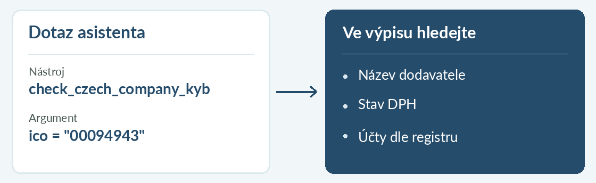

# EuroKYB pro AI asistenty

Připojte asistenta k registrům přes MCP. Můžete se ho česky zeptat na firmu, evropské DIČ, IBAN, kurz ČNB nebo obsah veřejné stránky a nechat si ukázat zdrojové údaje.

## Postup

1. V nastavení asistenta přidejte vzdálený server MCP. Jako adresu zadejte `https://alertviz.com/api/eurokyb/mcp` a vyberte přenos Streamable HTTP.
2. Pro klienta stdio stáhněte z oddílu Pro vývojáře archiv **npm (.tgz)** a rozbalte jej. Nastavte příkaz `node` (verze 18+) a jako argument úplnou cestu k `bin/eurokyb-mcp.mjs`. Předplatitelský klíč zadejte do `EUROKYB_API_KEY`.
3. Po připojení otevřete seznam nástrojů a zkuste dotaz níže. Požádejte asistenta, aby ve výsledku rozlišil známé a chybějící údaje.

## Vyzkoušejte

„Prověř IČO 00094943 pomocí `check_czech_company_kyb`. Vypiš název firmy, stav DPH a účty, které registr skutečně vrátil.“

## Jak číst výsledek

Argumenty nástrojů dostává hostovaná služba EuroKYB i při použití místního adaptéru. Při 429 naplánujte další pokus podle vrácené prodlevy. Stav UNKNOWN má zůstat jako neověřený údaj.

[Otevřít nástroj](https://alertviz.com/eurokyb/#developers)
