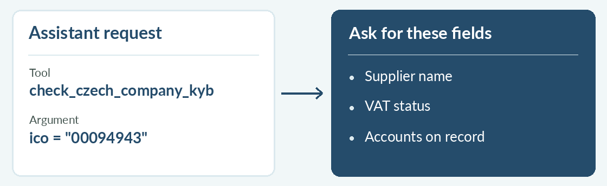

# EuroKYB for AI assistants

Connect an assistant to EuroKYB through MCP. Ask about a Czech company, EU VAT number, IBAN, Czech National Bank rate or public web page, then have the assistant show the underlying fields.

## How to use it

1. Add a remote MCP server in your assistant’s settings. Enter `https://alertviz.com/api/eurokyb/mcp` and select Streamable HTTP transport.
2. For a stdio client, download **npm (.tgz)** under For developers and extract it. Use `node` (version 18+) as the command and the full path to `bin/eurokyb-mcp.mjs` as its argument. Set `EUROKYB_API_KEY` for a subscription.
3. Connect and open the tool list. Try the question below. Ask the assistant to identify which fields the register actually returned.

## Try it

“Use `check_czech_company_kyb` for IČO 00094943. Give me the registered name, VAT status and the published accounts in the response.”

## Reading the result

Tool arguments reach the hosted EuroKYB service even when the bridge runs locally. If a request returns 429, schedule the next attempt using the reported delay. Keep UNKNOWN results marked as unverified.

[Open the tool](https://alertviz.com/eurokyb/en/#developers)
